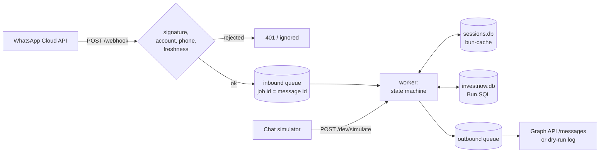
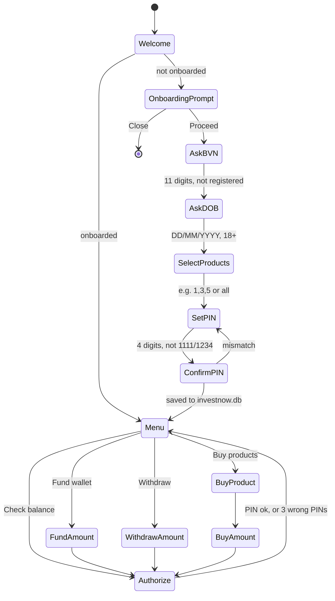

# ucap-whatsapp-api

**InvestNow on WhatsApp.** A NestJS service on [Bun](https://bun.sh) that
receives WhatsApp Business (Cloud API) webhooks and answers them through a
conversation state machine. Users onboard (BVN, date of birth, products, PIN),
then fund their wallet, check balances, withdraw and buy investment products,
all inside WhatsApp. Money and products are **dummy data** for now.

It ships with:

- a **chat simulator** (React) for talking to the bot as any WhatsApp number,
  without WhatsApp;
- an **admin area** with sign-in, every conversation with its source, live
  state and message log, session reset, and a **jobs dashboard** for the
  message queues;
- a **Dockerfile** for production.

---

## Contents

- [Stack](#stack)
- [Quick start](#quick-start)
- [How it works](#how-it-works)
- [The conversation](#the-conversation)
- [Configuration](#configuration)
- [HTTP endpoints](#http-endpoints)
- [Connecting WhatsApp](#connecting-whatsapp)
- [Admin area](#admin-area)
- [Chat simulator and the live typed client](#chat-simulator-and-the-live-typed-client)
- [Security](#security)
- [Storage](#storage)
- [Development](#development)
- [Testing and checks](#testing-and-checks)
- [Docker and deployment](#docker-and-deployment)
- [Project layout](#project-layout)
- [Conventions](#conventions)
- [Troubleshooting](#troubleshooting)
- [Known limitations](#known-limitations)

---

## Stack

| Piece                                                                                | What it does here                                                                                                                               |
| ------------------------------------------------------------------------------------ | ----------------------------------------------------------------------------------------------------------------------------------------------- |
| **Bun** ≥ 1.4.4                                                                      | Runtime, package manager, test runner (`bun test`), type checker (`bun check`), linter (`bun lint`), formatter (`bun fmt`), bundler for the UIs |
| **NestJS 12**                                                                        | Modules, controllers, guards, DI                                                                                                                |
| [`@kingsleyweb/bun-nest`](https://www.npmjs.com/package/@kingsleyweb/bun-nest)       | Nest's HTTP adapter on `Bun.serve`; `@Validate` with zod DTOs; the cache and jobs modules; `DevTypesModule` (the live type sync)                |
| [`@kingsleyweb/bun-cache`](https://www.npmjs.com/package/@kingsleyweb/bun-cache)     | Conversation sessions (SQLite driver, idle TTL), admin sessions, rate-limit counters                                                            |
| [`@kingsleyweb/bun-jobs`](https://www.npmjs.com/package/@kingsleyweb/bun-jobs)       | The inbound and outbound message queues (SQLite) and their management API                                                                       |
| [`@kingsleyweb/bun-jobs-ui`](https://www.npmjs.com/package/@kingsleyweb/bun-jobs-ui) | The queues dashboard at `/admin/jobs`                                                                                                           |
| [`@kingsleyweb/bun-client`](https://www.npmjs.com/package/@kingsleyweb/bun-client)   | The UIs' typed HTTP client, regenerated from the API as it changes                                                                              |
| `Bun.SQL` (SQLite)                                                                   | Users, products, transactions, admins, the session log                                                                                          |
| Drizzle (`drizzle-orm`, `drizzle-kit`)                                               | The schema model and its timestamped SQL migrations                                                                                             |
| `@nestjs/throttler`                                                                  | Rate limits (on a bun-cache storage)                                                                                                            |
| `zod`                                                                                | DTOs: request, response and webhook schemas                                                                                                     |
| `phone`                                                                              | Mobile-number validation (API and UI)                                                                                                           |
| React 19                                                                             | The chat simulator and the admin UI                                                                                                             |

The `@kingsleyweb/*` packages are on `3.0.0-rc.0`, the release line that has the cache and jobs modules.

---

## Quick start

```bash
bun install
cp .env.example .env        # optional in development: every value has a default
echo 'ADMIN_EMAIL=you@example.com
ADMIN_USERNAME=you
ADMIN_PASSWORD=Choose-A-Strong-One-1' >> .env

bun run dev:all
```

`dev:all` starts two processes in one terminal:

| Process   | Command                   | What it does                                                                                                                                 |
| --------- | ------------------------- | -------------------------------------------------------------------------------------------------------------------------------------------- |
| API       | `bun --watch src/main.ts` | The service on <http://127.0.0.1:3000>, restarted on every server change. In development it also serves the UIs from source, with hot reload |
| Type sync | `bun-client watch`        | Rewrites `ui/src/api.gen.ts` whenever the API's routes or schemas change                                                                     |

Then open:

|                | URL                                                |
| -------------- | -------------------------------------------------- |
| Chat simulator | <http://127.0.0.1:3000/chat> (`/` redirects there) |
| Admin          | <http://127.0.0.1:3000/admin/>                     |
| Jobs dashboard | <http://127.0.0.1:3000/admin/jobs/>                |

Open the chat simulator, enter any valid mobile number (e.g. `0803 123 4567`
with Nigeria selected) and say **hi**.

Without WhatsApp credentials the service runs **dry**: replies are logged to the
console instead of being sent, and recorded at `GET /dev/outbox`.

---

## How it works



1. **The webhook answers at once.** It verifies the delivery (see
   [Security](#security)) and puts each message on the **inbound** bun-jobs
   queue. The job id is the WhatsApp message id, so Meta's redeliveries are
   dropped as duplicates.
2. **A worker runs the state machine.** It loads the user's session from
   bun-cache and their account from SQLite, works out the next step and the
   replies, and saves the new session. Each inbound job runs **once**: a retry
   after the session moved on would answer the wrong step.
3. **Replies go through the outbound queue**, sent in order and **retried**
   with exponential backoff on 429/5xx. The job's progress records which
   messages already went out, so a retry never sends one twice. A 4xx other
   than 429 fails the job for good.
4. One user's messages are handled one at a time, in order; different users are handled concurrently.

The chat simulator calls the state machine directly (`POST /dev/simulate`),
skipping the queues, so its replies come back in the response.

---

## The conversation



- **Welcome:** a new user gets **Proceed** and **Close** buttons; an onboarded user gets the menu.
  New users, and anyone whose session closes, are also told about InvestNow's USSD service, `*7277#`.
- **Onboarding:**
  - **BVN**: 11 digits, not already registered. The prompt tells users who don't know it to dial `*565*0#`.
  - **Date of birth**: `DD/MM/YYYY`, `DD-MM-YYYY`, `DD.MM.YYYY` or `YYYY-MM-DD`; the user must be at least 18.
  - **Products**: Money Market Fund, Fixed Income Fund, Balanced Fund, Equity
    Fund, Stocks and Trustees. Several can be chosen as `1,3,5`, `1 3 5`, `1, 3 and 5` or `all`.
  - **PIN**: 4 digits, with repeated digits and sequences refused, then confirmed.
    It is stored only as an argon2id hash (`Bun.password`), including while it is being confirmed.
- **Menu** (an interactive list, or reply `1`–`5`):
  - **Fund wallet**: amount, then PIN.
  - **Check balance**: PIN, then the wallet, each product and the total.
  - **Withdraw**: amount (up to the wallet balance), then PIN.
  - **Buy products**: product, amount (up to the wallet balance), then PIN. This moves money from the wallet into the product.
- **Amounts:** `5000`, `5,000`, `₦5,000.50`, `N5000` and `5k` all work; the range is ₦100 to ₦10,000,000.
- **Everywhere:** `MENU` goes back to the menu, `CANCEL` (`exit`, `stop`, `close`, …) ends the session, and `hi` starts over.
  Three wrong PINs cancel the pending request. A session expires after 24 h of inactivity (`SESSION_TTL_MS`).

Dummy behaviour: funding always succeeds instantly, and so do withdrawals ("on
its way to your bank account"). Each transaction gets a reference and a row in
`transactions`.

---

## Configuration

Everything is read from the environment (Bun loads `.env` automatically). See `.env.example`.

| Variable                                          | Default                                       | Meaning                                                                                                                                                             |
| ------------------------------------------------- | --------------------------------------------- | ------------------------------------------------------------------------------------------------------------------------------------------------------------------- |
| `PORT`                                            | `3000`                                        | HTTP port                                                                                                                                                           |
| `HOST`                                            | `0.0.0.0`                                     | Bind address                                                                                                                                                        |
| `NODE_ENV`                                        |                                               | `production` turns on the production checks below                                                                                                                   |
| `TRUSTED_PROXIES`                                 | `0`                                           | Reverse-proxy hops whose `X-Forwarded-For` is trusted for client IPs. `0` uses the socket peer                                                                      |
| `CLIENT_IP_HEADER`                                |                                               | A header holding the client's address, set by a proxy that overwrites it on every request: `x-real-ip` on Railway. Wins over `TRUSTED_PROXIES` when it holds one IP |
| `DATA_DIR`                                        | `./data`                                      | Where the SQLite files live (`:memory:` keeps everything in-process; the tests use it)                                                                              |
| `SESSION_TTL_MS`                                  | `86400000` (24 h)                             | Idle time before a conversation resets                                                                                                                              |
| `MIGRATE_ON_START`                                | on outside production; on in the Docker image | Apply pending migrations at startup. Off: a pending migration refuses the start                                                                                     |
| `ENABLE_DEV_ROUTES`                               | on outside production                         | The simulator API, the chat UI at `/chat` and the dev type sync. Refused in production                                                                              |
| `WHATSAPP_VERIFY_TOKEN`                           |                                               | The token Meta echoes when you register the webhook                                                                                                                 |
| `WHATSAPP_APP_SECRET`                             |                                               | Signs every delivery (`X-Hub-Signature-256`). Unset: signatures **not** checked (dev only)                                                                          |
| `WHATSAPP_ACCESS_TOKEN`                           |                                               | Graph API token. Unset: dry-run                                                                                                                                     |
| `WHATSAPP_PHONE_NUMBER_ID`                        |                                               | The business number replies are sent from, which deliveries must be for. Unset: dry-run                                                                             |
| `WHATSAPP_BUSINESS_ACCOUNT_ID`                    |                                               | Deliveries for any other business account are ignored. Unset: any                                                                                                   |
| `WEBHOOK_MAX_MESSAGE_AGE_SECONDS`                 | `86400`                                       | Older messages are dropped as stale or replayed                                                                                                                     |
| `WHATSAPP_GRAPH_API_VERSION`                      | `v26.0`                                       | Graph API version replies are sent with (`v26.0` is the newest as of November 2026)                                                                                 |
| `ADMIN_EMAIL`, `ADMIN_USERNAME`, `ADMIN_PASSWORD` |                                               | When all three are set, this admin is created at startup (or has its password reset)                                                                                |
| `ADMIN_SESSION_TTL_MS`                            | `28800000` (8 h)                              | How long an admin stays signed in                                                                                                                                   |

**In production** (`NODE_ENV=production`) the service refuses to start without
`WHATSAPP_VERIFY_TOKEN`, `WHATSAPP_APP_SECRET`, `WHATSAPP_ACCESS_TOKEN` and
`WHATSAPP_PHONE_NUMBER_ID`, or with `ENABLE_DEV_ROUTES` on.

---

## HTTP endpoints

| Method and path                        | Auth                       | Throttle                | What                                                                                                             |
| -------------------------------------- | -------------------------- | ----------------------- | ---------------------------------------------------------------------------------------------------------------- |
| `GET /webhook`                         | verify token               | none                    | Meta's verification handshake: echoes `hub.challenge`                                                            |
| `POST /webhook`                        | signature                  | none                    | Deliveries (messages, statuses)                                                                                  |
| `GET /health`                          |                            | 120/min                 | Status and the server's date and time ([example](#endpoint-examples))                                            |
| `GET /admin`                           |                            |                         | The admin UI (from source with hot reload in development, otherwise the built one)                               |
| `POST /admin/api/login`                |                            | 10/min, then 15 min out | `{ identifier, password }` → sets the session cookie                                                             |
| `POST /admin/api/logout`               | cookie                     | 120/min                 |                                                                                                                  |
| `GET /admin/api/me`                    | cookie                     | 120/min                 | The signed-in admin                                                                                              |
| `GET /admin/api/sessions`              | cookie                     | 120/min                 | Conversations, filtered by `source`, `status` and `search`, paged by `page` and `pageSize`                       |
| `GET /admin/api/sessions/:waId`        | cookie                     | 120/min                 | Live state (secrets redacted), account, message log                                                              |
| `POST /admin/api/sessions/:waId/reset` | cookie                     | 120/min                 | Ends the conversation                                                                                            |
| `GET /admin/jobs/`                     | cookie                     | 120/min                 | The bun-jobs-ui dashboard (redirects to sign-in)                                                                 |
| `/admin/jobs-api/*`                    | cookie                     | 300/min                 | The bun-jobs management API (+ live-events WebSocket)                                                            |
| `POST /dev/simulate`                   | dev only                   | 60/min                  | Send one message as a WhatsApp user ([example](#endpoint-examples))                                              |
| `DELETE /dev/users/:waId`              | dev only                   | 10/min                  | Deletes a test user and their session                                                                            |
| `GET /dev/outbox`                      | dev only                   | 120/min                 | What dry-run recorded                                                                                            |
| `GET /chat`                            | dev only                   |                         | The chat simulator (from source with hot reload in development, otherwise the built one); `GET /` redirects here |
| `/__bun/types/*`                       | dev only, loopback + token |                         | The live type sync (`DevTypesModule`)                                                                            |

Validation errors answer `400` with `{ statusCode, message: string[], error }`.

### Endpoint examples

`GET /health`:

```json
{
  "status": "ok",
  "serverTime": "2026-11-04T13:05:12.345Z",
  "epochMs": 1793797512345
}
```

`serverTime` is the server's date and time in UTC (ISO 8601, milliseconds); `epochMs` is the same instant in milliseconds since the Unix epoch.

`POST /dev/simulate`:

```json
{
  "from": "2348031234567",
  "name": "Ada Obi",
  "text": "Proceed",
  "choiceId": "onboard:proceed"
}
```

answers `{ "step": "ask_bvn", "replies": [ … ], "transcript": "…" }`. `from` must be a valid mobile number in international format without the `+`; `choiceId` is the id of a tapped button or list row.

`GET /admin/api/sessions?source=whatsapp&status=active&search=0803&page=1&pageSize=25` lists sessions; `source` is `whatsapp` or `simulator`, `status` is `active`, `expired` or `ended`.

---

## Connecting WhatsApp

1. In the [Meta developer dashboard](https://developers.facebook.com/), create
   an app with the **WhatsApp** product, and note the **phone number ID**, the
   **WhatsApp Business Account ID**, an access token (a System User token for
   production), and the app secret (_App settings → Basic_).
2. Set `WHATSAPP_PHONE_NUMBER_ID`, `WHATSAPP_BUSINESS_ACCOUNT_ID`,
   `WHATSAPP_ACCESS_TOKEN`, `WHATSAPP_APP_SECRET`, and a `WHATSAPP_VERIFY_TOKEN` you make up.
3. Expose the service over HTTPS (a deployment, or a tunnel to port 3000 while testing).
4. Under _WhatsApp → Configuration → Webhook_, set the callback URL to
   `https://<your-host>/webhook` and the verify token to `WHATSAPP_VERIFY_TOKEN`,
   then subscribe to the **messages** field.
5. Message the business number. The reply arrives through the outbound queue,
   which you can watch at `/admin/jobs`.

Interactive messages used: reply buttons (up to 3) and lists (up to 10 rows).
Product multi-select is a numbered text reply, since WhatsApp lists are single-select.

---

## Admin area

`/admin` on the API: served from source with hot reload in development, otherwise the built UI.

- **Accounts.** Set `ADMIN_EMAIL`, `ADMIN_USERNAME` and `ADMIN_PASSWORD` (created
  or reset at startup), or run:

  ```bash
  bun run admin:create --email ops@example.com --username ops   # prompts for the password
  ```

  A password needs 12+ characters, three of: lower case, upper case, digits,
  symbols, and must not contain the username or email.

- **Sign-in:** email (any case) or username, plus password. You get an HttpOnly,
  SameSite=Strict cookie scoped to `/admin` (`Secure` in production) that lasts 8 h.
  An account locks for 15 minutes after 5 wrong passwords; an address is limited to 10 attempts a minute.
- **Sessions:**
  - Counts of active, WhatsApp, simulator and all conversations.
  - A list you can filter by source and status and search by number or name. It refreshes every 5 s.
  - Each session shows its step, timestamps, the live state machine state
    (the PIN hash redacted, the BVN masked), the account and holdings, and the full message log.
    PINs are logged as `••••` and BVNs masked.
  - **Reset session** ends a conversation; the user's next message starts from the welcome.
- **Jobs dashboard:** `/admin/jobs`, the bun-jobs-ui over the management API.
  It shows queues, jobs, workers, throughput and live events, and lets you retry or remove jobs and pause workers.

---

## Chat simulator and the live typed client

The simulator at <http://127.0.0.1:3000/chat> asks for a country and a mobile
number. The `phone` package validates it as a real mobile number, both in the
browser and again on the server. You then chat as that number: WhatsApp-style
bubbles, reply buttons, list menus as a bottom sheet, and WhatsApp's
`*bold*` / `_italic_` / ` ```mono``` ` formatting. History is kept per
number in the browser. **Reset number** deletes the account so you can onboard again.

Both UIs call the API through `@kingsleyweb/bun-client`, typed by
`ui/src/api.gen.ts`:

- In development, bun-nest's `DevTypesModule` serves the API's OpenAPI
  document (only the UI-facing routes: `/dev/*`, `/admin/api/*` and `/health`)
  and announces every change. `bun-client watch` rewrites `api.gen.ts`
  about 100 ms after you save a controller or DTO, so a renamed field shows up as a
  type error in the UI straight away.
- The client also **validates** requests and responses with the server's own
  zod DTOs (`src/dev/dev.dto.ts`, `src/admin/admin.dto.ts`), the mobile-number check included.
- `bun run ui:types:generate` rebuilds the file with no server running.
  `bun run ui:types:check` fails if it is stale; it is part of `bun run verify`.

---

## Security

**Webhook: proof of origin instead of throttling.** Meta's traffic is never
rate-limited; a delivery is accepted only when:

1. its `X-Hub-Signature-256` is the HMAC-SHA256 of the **raw** body, keyed with
   `WHATSAPP_APP_SECRET` and compared in constant time;
2. it is a `whatsapp_business_account` delivery for **our** business account
   (`entry[].id`) and **our** phone number (`metadata.phone_number_id`). A
   signed delivery for anything else is acknowledged (so Meta stops retrying)
   and ignored;
3. each message is **fresh**: no older than `WEBHOOK_MAX_MESSAGE_AGE_SECONDS`,
   not from the future, and from a plausible WhatsApp id. Replays inside the
   window are de-duplicated by the queue's job ids.

An address that fails the signature or verify-token check 10 times in 10 minutes
is blocked for an hour, and its requests are refused before the body is even hashed.

**Everything else** goes through `@nestjs/throttler`, with a storage on
bun-cache (`security.db`, so limits survive restarts and are shared by
processes on the host). The limits are in [HTTP endpoints](#http-endpoints). The jobs API and
dashboard are mounted below Nest's guards, so they get the same limits as middleware.

**Also:**

- Client IPs come from `CLIENT_IP_HEADER` when it is set and holds one address, otherwise from the
  socket peer, or `TRUSTED_PROXIES` hops into `X-Forwarded-For`. bun-nest always parses
  `X-Forwarded-For`, so these settings are what stop clients choosing their own IP. On Railway, set
  `CLIENT_IP_HEADER=x-real-ip`: its edge overwrites that header with the connecting client on every
  request, while `X-Forwarded-For` carries a varying number of CDN hops (counting them gave CDN
  addresses for every caller). Set it only behind such a proxy.
- Request bodies are capped at 1 MB.
- The admin page sends `X-Frame-Options: DENY`, `Referrer-Policy: no-referrer`
  and `Cache-Control: no-store`, and bun-jobs-ui sets its own strict CSP. The jobs
  API refuses cross-site mutations and WebSocket upgrades.
- PINs and admin passwords are stored as argon2id hashes. Admin session tokens
  are random 256-bit values stored only as SHA-256 hashes.

---

## Storage

All state is SQLite under `DATA_DIR`, in WAL mode:

| File           | Contents                                                                                                      | Through   |
| -------------- | ------------------------------------------------------------------------------------------------------------- | --------- |
| `investnow.db` | `users`, `user_products` (holdings), `transactions`, `admins`, `conversation_sessions`, `conversation_events` | `Bun.SQL` |
| `sessions.db`  | live conversation state, expiring after `SESSION_TTL_MS`                                                      | bun-cache |
| `jobs.db`      | the inbound and outbound queues                                                                               | bun-jobs  |
| `admin.db`     | admin sign-in sessions                                                                                        | bun-cache |
| `security.db`  | rate limits, login failures, origin blocks                                                                    | bun-cache |

Money is stored as integer **kobo**. To start over in development, stop the service and delete `./data`.

### Migrations

`investnow.db`'s schema is **model-driven**, with [Drizzle](https://orm.drizzle.team):

- **The model** is `src/database/schema.ts`: every table, column, index and CHECK
  constraint. The repositories' domain types come from it (`typeof users.$inferSelect`).
  The queries themselves stay hand-written on `Bun.SQL`.
- **Migrations** are timestamped SQL files that `drizzle-kit` writes from the
  model into `migrations/`, e.g. `migrations/20261104140152_initial.sql`.
  `migrations/meta/` holds drizzle-kit's journal and its snapshot of the model
  after each migration.
- **Applied migrations** are recorded in `__drizzle_migrations` (a hash of each
  file and its timestamp), the same table drizzle's own migrator keeps. The app
  applies them with its own small runner on `Bun.SQL`
  (`src/database/migrator.ts`), all pending ones in one transaction.

Changing the schema:

```bash
# 1. edit src/database/schema.ts
bun run db:generate -- --name add_kyc_level   # writes migrations/<timestamp>_add_kyc_level.sql (review it)
bun run db:status                             # what this database has applied, and what is pending
bun run db:migrate                            # apply (development also applies on start)
```

`bun run db:status` lists every migration as one of:

| State      | Meaning                                                                                                                     |
| ---------- | --------------------------------------------------------------------------------------------------------------------------- |
| `applied`  | recorded, and the file still matches its hash                                                                               |
| `pending`  | newer than the last applied migration: the next `db:migrate` runs it                                                        |
| `modified` | applied, but the file changed since. Never edit an applied migration; write a new one                                       |
| `skipped`  | never applied, but older than the last applied one, so it will never run (e.g. a branch merged out of order). Regenerate it |
| `missing`  | recorded in the database, but its file is gone                                                                              |

`db:migrate` and the startup refuse to run while anything is `modified` or
`skipped`. `bun run db:check`, part of `bun run verify`, fails when the model has
changes that no migration covers.

**On start**, pending migrations are applied when `MIGRATE_ON_START` is on (the
default outside production, and in the Docker image). With it off, a pending
migration stops the start with a message naming it: run `bun run db:migrate`
as a release step instead.

Migrations are forward-only, as with drizzle-kit: undo a change with a new migration.
The bun-cache and bun-jobs stores (`sessions.db`, `jobs.db`, `admin.db`, `security.db`)
manage their own schemas and are not part of the model.

---

## Development

| Command                                | What it does                                                |
| -------------------------------------- | ----------------------------------------------------------- |
| `bun run dev:all`                      | API + UIs + type sync, in one terminal                      |
| `bun run dev`                          | The API alone (`bun --watch`), serving the UIs from source  |
| `bun run ui:types`                     | The type sync alone                                         |
| `bun run ui:types:generate`            | Regenerate `ui/src/api.gen.ts` without a server             |
| `bun run ui:build`                     | Production builds of both UIs into `dist/`                  |
| `bun run admin:create`                 | Create an admin, or reset their password                    |
| `bun run start`                        | The API, without watching                                   |
| `bun run db:generate -- --name <what>` | Write a timestamped migration from the model                |
| `bun run db:status`                    | Applied / pending / modified / skipped / missing migrations |
| `bun run db:migrate`                   | Apply pending migrations                                    |
| `bun run db:check`                     | Fail if the model has changes no migration covers           |

**The UIs in development.** There is no separate UI server. When the API runs
in development (`ENABLE_DEV_ROUTES` on, `NODE_ENV` not `production`), it serves
`ui/index.html` at `/chat` and `ui/admin.html` at `/admin` as native `Bun.serve`
routes, ahead of Nest. Bun bundles the TSX and nested CSS on request, with no
other build tooling, and pushes changes to the open page (hot module
replacement), so editing a UI file doesn't restart the API. The UIs and the API
share one origin, so the admin cookie, the jobs dashboard's WebSocket and the
typed client need no proxy or CORS. In production (and in the tests) the built
`dist/` is served instead (`bun run ui:build`), and the UI source is never loaded.

Run everything from the project root: Bun reads `emitDecoratorMetadata`, which
Nest's dependency injection needs, from the working directory's `tsconfig.json`.

---

## Testing and checks

```bash
bun test           # 94 tests: parsers, state machine, webhook + origin checks, admin + throttling, migrator
bun run verify     # bun check, bun lint, bun fmt --check, db:check, ui:types:check, bun test
bun format         # bun fmt
```

The tests boot the real application with `DATA_DIR=:memory:` (memory drivers
for bun-cache and bun-jobs, in-memory SQLite) and talk to it over HTTP.

---

## Docker and deployment

```bash
docker build -t ucap-whatsapp-api .
docker run -d --name investnow -p 3000:3000 \
  -v investnow-data:/data --env-file .env.production \
  ucap-whatsapp-api
```

- The build has three stages: bundle the UIs, install production dependencies
  only, then a slim runtime on `oven/bun:1.4.4-slim` running as the `bun` user.
- It runs in production mode. Both UIs are built in: the admin UI is served at `/admin`; the chat
  simulator at `/chat` (and `/` redirects there) only when `ENABLE_DEV_ROUTES=true`, as in a
  development environment, together with the `/dev` API it calls. In production neither is
  routed, and the type sync is never on.
- State lives in the `/data` volume; back it up. Run **one** container per volume:
  SQLite and the per-user ordering are single-host.
- It has a healthcheck on `GET /health`.
- Pending migrations are applied on start (`MIGRATE_ON_START=true` in the image). To inspect or
  migrate by hand: `docker exec investnow bun scripts/db.ts status` (or `migrate`). Create an
  admin with `docker exec -it investnow bun scripts/create-admin.ts --email … --username …`.
- Put it behind HTTPS, since Meta requires it and the admin cookie is `Secure`. Set
  `TRUSTED_PROXIES=1` behind one reverse proxy (on Railway, `CLIENT_IP_HEADER=x-real-ip` instead).

---

## Project layout

```
src/
  main.ts                bootstrap: adapter, body limit, static UIs
  app.module.ts          module wiring
  config.ts              loadConfig(); types in config.interface.ts
  whatsapp/              webhook controller + signature guard, origin checks, Graph API client,
                         message builders, webhook DTOs and mapper
  queue/                 the bun-jobs context, inbound/outbound queues and workers
  conversation/          the state machine, input parsers, product catalogue, keyed mutex
  database/              Drizzle schema model, the Bun.SQL migrator, users and session-log repositories
  admin/                 sign-in, admin API and page, jobs API + dashboard mounts
  security/              throttler storage on bun-cache, client IP
  dev/                   the simulator API and the UI-facing OpenAPI document
  shared/                phone validation, used by the API and the UIs
ui/
  index.html, src/       the chat simulator
  admin.html, src/admin/ the admin UI
  src/api.gen.ts         generated typed client (do not edit)
migrations/              timestamped SQL migrations generated from the model (+ drizzle-kit's meta/)
scripts/                 dev runner, migrations (db.ts), admin creation, OpenAPI export
test/                    bun tests
Dockerfile, .dockerignore
drizzle.config.ts        drizzle-kit settings (model, output folder, timestamp prefix)
```

---

## Conventions

- Each module keeps its zod **DTOs** in `<name>.dto.ts`, with schemas named
  `…Dto`. Its **types** live in `<name>.interface.ts`, where the inferred types keep the
  plain names (`SimulateBodyDto` → `SimulateBody`). The DTO files the UIs
  import (`dev.dto.ts`, `admin.dto.ts`) stay browser-safe: zod and `src/shared/*` only.
- New dependencies outside `@kingsleyweb/*` need sign-off first.
- Lint with `bun lint` and format with `bun fmt` (`bun format`). Don't add
  package.json scripts named `check` or `lint`: they shadow Bun's built-ins.
- Schema changes go through the model: edit `src/database/schema.ts`, run
  `bun run db:generate`, and commit the generated migration. Never edit an applied one.
- Git: the default branch is `develop`, and every change goes branch → commit → PR → merge.
  Every commit is signed: `develop` requires verified signatures.

---

## Troubleshooting

| Symptom                                                        | Likely cause                                                                                      |
| -------------------------------------------------------------- | ------------------------------------------------------------------------------------------------- |
| Nest can't resolve a constructor dependency (`?` in the error) | Not run from the project root: Bun didn't read `tsconfig.json`'s `emitDecoratorMetadata`          |
| `401 Invalid webhook signature` from Meta's test button        | `WHATSAPP_APP_SECRET` is not the app's secret, or a proxy rewrote the body                        |
| `403 Blocked` on the webhook                                   | That IP failed the signature/verify check 10 times; wait an hour, or clear `security.db` in dev   |
| Webhook returns `200 {"received":0}`                           | Payload for another account or phone number, or stale messages: see the `WebhookOrigin` log lines |
| Replies never arrive                                           | Dry-run (no token or phone number id), or the outbound job is retrying/dead: check `/admin/jobs`  |
| `429` on admin sign-in                                         | 10/min per address, or the account's 5-failure lockout; wait 15 minutes                           |
| `/admin` answers 503                                           | Production without the built UI: `bun run ui:build` (the Docker image builds it)                  |
| `/admin/jobs` keeps redirecting to sign-in                     | The cookie is `Secure` in production: serve over HTTPS                                            |
| Start fails: `investnow.db is not up to date`                  | Pending migrations with `MIGRATE_ON_START` off: run `bun run db:migrate`                          |
| `Migrations and database disagree: … is modified`              | An applied migration file was edited: restore it from git, put the change in a new migration      |
| `db:check` fails                                               | The model changed without a migration: `bun run db:generate -- --name <what>`                     |
| `ui:types:check` fails                                         | Run `bun run ui:types:generate` and commit `ui/src/api.gen.ts`                                    |

---

## Known limitations

- **Dummy money:** no payment gateway, no real transfers, no BVN verification.
- **PINs travel as chat messages,** so they stay in the user's WhatsApp history.
  WhatsApp Flows would collect them in a form instead.
- **BVNs are stored unencrypted** in `investnow.db`.
- **Single host:** SQLite, and a per-user message ordering that holds within one
  process. Scaling out means a shared driver (Postgres/Redis are supported by
  bun-cache and bun-jobs) and a cross-process lock.
- Media messages (images, voice notes, locations) get a "text only" reply.
